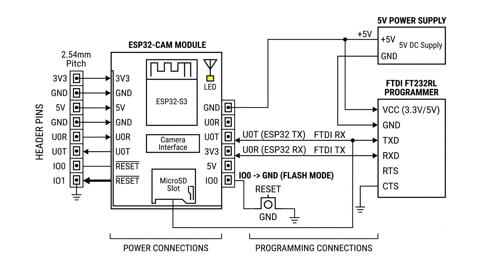

# Edge-AI Fire and Smoke Detection System using YOLOv8n and ESP32-CAM

An end-to-end computer vision and IoT project that streams live video from an ESP32-CAM module to a host computer, runs a fine-tuned **YOLOv8-nano** model to detect fire and smoke in real time, classifies detection sizes using geometric area ratios, and prepares an INT8-quantised TensorFlow Lite model with a C header for microcontroller deployment.

---

## 🚀 Key Features
- **Real-Time Video Streaming:** Captures and streams MJPEG video from an ESP32-CAM over Wi-Fi (`/stream` endpoint).
- **Threaded Frame Receiver:** Utilizes a background daemon thread to continuously grab frames, eliminating frame-buffer lag during high-load inference.
- **YOLOv8n Fire & Smoke Detection:** Fine-tuned on a custom dataset achieving a validation mAP@50 of ~0.57.
- **Dynamic Size Classification:** Computes bounding-box area ratios relative to the frame ($\text{Area} < 5\% \rightarrow$ **Small Fire** in yellow; $\text{Area} \ge 5\% \rightarrow$ **Large Fire** in red).
- **Edge Deployment Preparation:** Exports PyTorch weights (`.pt`) to an INT8-quantised TensorFlow Lite model (`.tflite`) and generates a C byte-array header (`.h`) for future ESP32-S3 deployment.

---

## 🛠️ Tech Stack
- **Languages:** Python 3, C/C++ (ESP32 Firmware)
- **ML Framework:** Ultralytics YOLOv8, PyTorch, TensorFlow Lite
- **Libraries:** OpenCV, NumPy, PyYAML
- **Hardware:** ESP32-CAM (OV2640 camera module), FTDI programmer, 5V power supply

---

## 🔌 Circuit Diagram & Pin Configuration



| Signal | ESP32-CAM Pin | Connected To | Description / Purpose |
| :--- | :--- | :--- | :--- |
| **UART TX / RX** | U0T / U0R | FTDI RX / TX | Serial communication for flashing firmware and debugging |
| **Flash Mode** | IO0 | GND (during flashing) | Pulled LOW for bootloader mode; open for normal run mode |
| **Power Supply** | 5V, GND | Regulated 5V supply | External 5V 2A power rail |


## 🔌 Demo Video 

<video src=["Link"](https://drive.google.com/file/d/1WS0lx16DcyPOYbd2wdtH6GIZigwTiUDK/view?usp=drive_link)></video>


## 📁 Repository Directory Structure

```text
ESP32-CAM-YOLOv8-Fire-Smoke-Detection/
├── train/                  # Training set (images & labels)
├── valid/                  # Validation set (images & labels)
├── test/                   # Test set (images & labels)
├── best.pt                 # Fine-tuned YOLOv8n PyTorch model weights
├── data.yaml               # Dataset configuration file (classes: fire, smoke)
├── fire_project.ipynb      # Jupyter notebook for Colab training & TFLite/C-header export
├── main.py                 # Live inference pipeline with threaded video stream receiver
├── README.dataset.txt      # Dataset information and metadata
└── README.roboflow.txt     # Dataset origin and Roboflow citation
